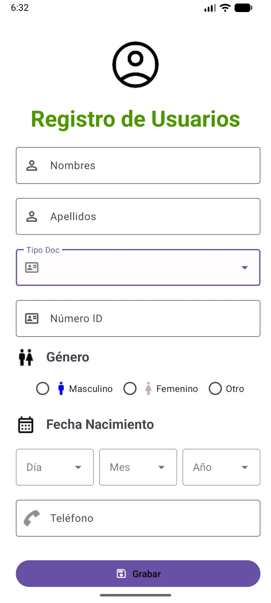

# Practica_semana_2

Tiene una pantalla de **Registro de Usuarios** con un formulario. La pantalla usa `ConstraintLayout` dentro de un `ScrollView` y componentes de Material Design.

  

## Características

La interfaz usa componentes de Material Design (`TextInputLayout` con estilo *Outline*) e incluye:

- **Usuario:** encabezado con la imagen `user` y el título "Registro de Usuarios" en verde.
- **Nombres y Apellidos:** campos de texto con el ícono `person`.
- **Tipo de Documento:** menú desplegable (*Exposed Dropdown Menu*) con las opciones Cédula, Pasaporte y RUC.
- **Número ID:** campo numérico de hasta 10 dígitos con el ícono `documento`.
- **Género:** grupo de botones de radio (`RadioGroup`) con Masculino, Femenino y Otro, cada uno con su propio ícono.
- **Fecha de Nacimiento:** tres menús desplegables en una fila (`LinearLayout` horizontal) para el día, el mes y el año, con el ícono `calendario`.
- **Teléfono:** campo de texto de tipo `phone`.
- **Botón Grabar:** botón principal con el ícono `save`.

## Detalles técnicos

- **Lenguaje:** Kotlin.
- **Diseño de interfaz:** hecho en XML (`activity_main.xml`).
- **Layouts:** `ScrollView` para desplazarse en pantallas pequeñas y `ConstraintLayout` para ubicar los elementos unos respecto de otros.
- **Menús desplegables:** `MaterialAutoCompleteTextView` con `app:simpleItems`.
- **Recursos:** las opciones de los desplegables están en `strings.xml` como `<string-array>` (`tipo_documento`, `dias`, `meses`, `anios`).
- **SDK:** `minSdk 34`, `targetSdk 37`.
